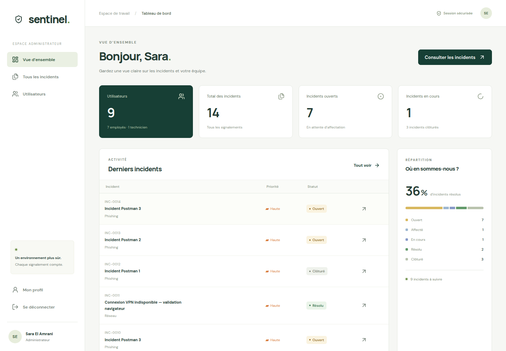
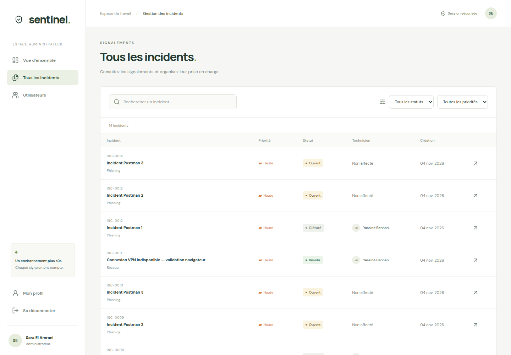
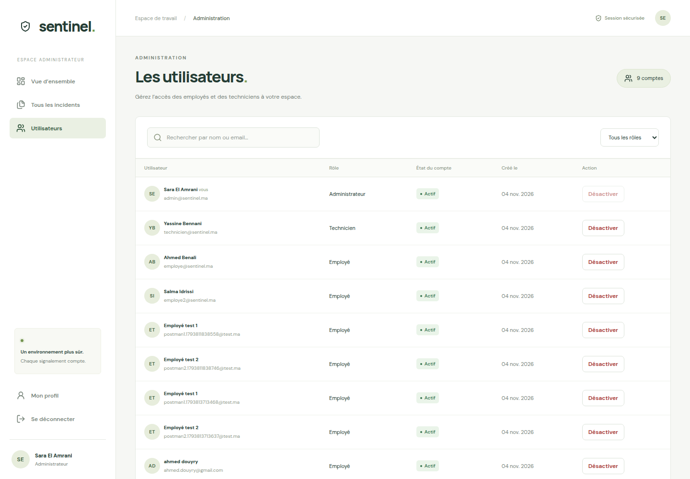
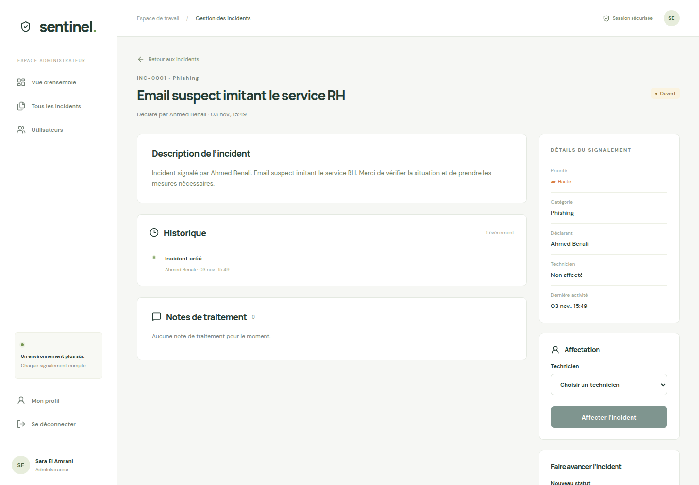
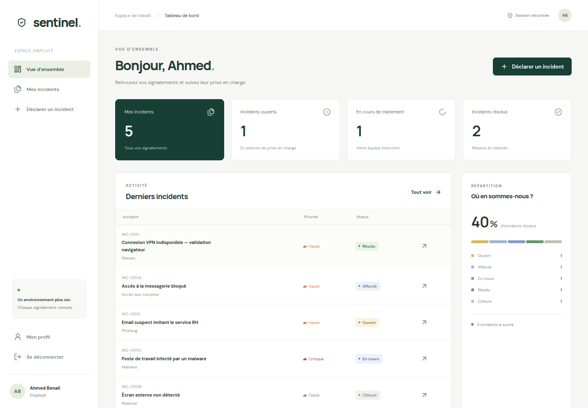
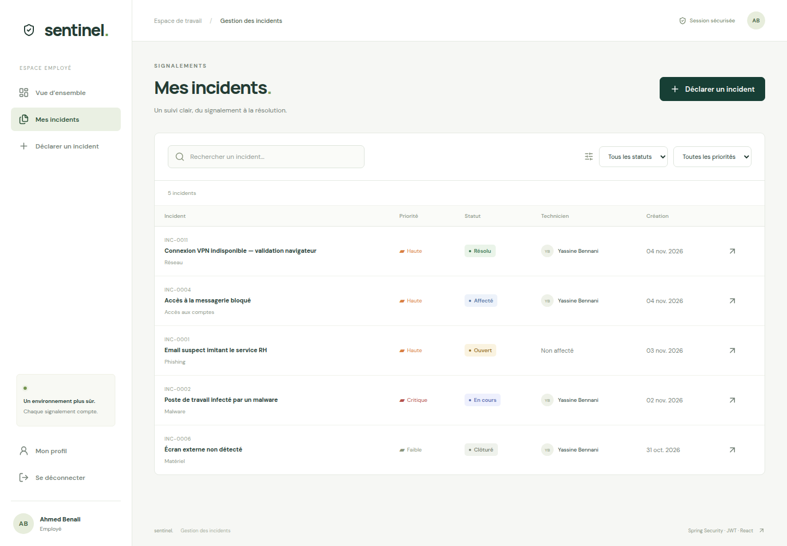
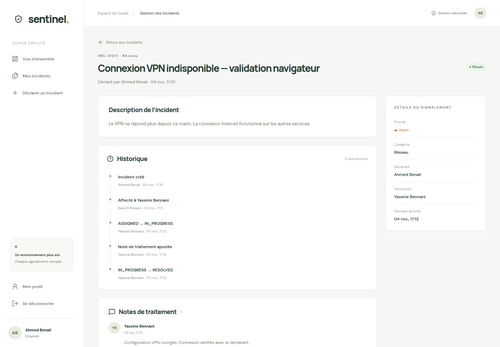
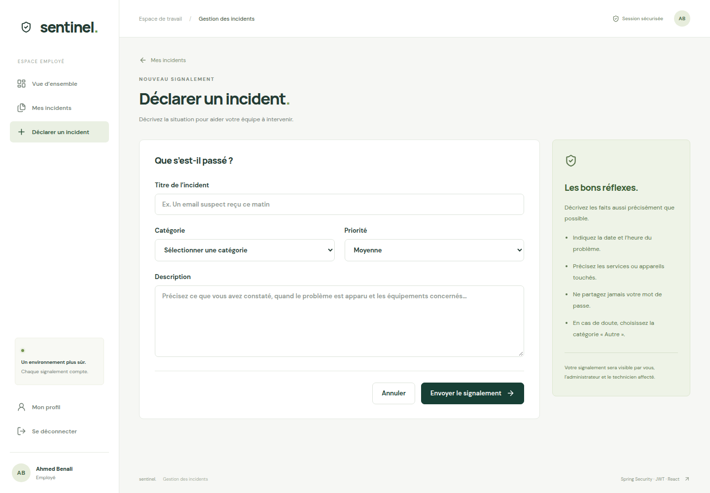
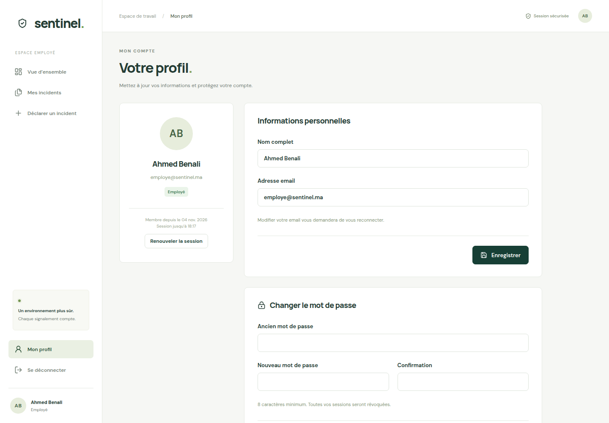

# Sentinel — Gestion sécurisée des incidents

Application du devoir **Spring Security – JWT – React** : déclaration, affectation, traitement et suivi d’incidents informatiques et de cybersécurité. Interface en français, adaptée au bureau et au mobile.

## Démarrage

Prérequis : **Java 21**, **Maven 3.8+**, **Node.js 22.12+**, npm. Deux terminaux sont nécessaires.

Backend :

```bash
cd backend
mvn spring-boot:run
```

Frontend :

```bash
cd frontend
npm ci
npm run dev
```

Ouvrir **http://localhost:5173**. API : **http://localhost:8081**. Les données sont conservées dans `backend/data/sentinel.mv.db` par H2. Les données de démonstration sont insérées uniquement si la table des utilisateurs est vide. Le projet utilise Spring Boot 3.5.16, Spring Security 6, JPA, Jakarta Validation, JJWT 0.13 et React 19 avec TypeScript (les composants `.tsx` remplacent les `.jsx` du sujet).

Console H2 locale : http://localhost:8081/h2-console, JDBC `jdbc:h2:file:./data/sentinel`, utilisateur `sa`, mot de passe vide. Ne pas ouvrir simultanément le fichier H2 depuis un autre processus.

## Comptes de démonstration

Mot de passe commun : **`Demo2026!`**.

| Rôle | Email | Nom |
| --- | --- | --- |
| ADMIN | admin@sentinel.ma | Sara El Amrani |
| TECHNICIAN | technicien@sentinel.ma | Yassine Bennani |
| EMPLOYEE | employe@sentinel.ma | Ahmed Benali |
| EMPLOYEE | employe2@sentinel.ma | Salma Idrissi |

L’inscription publique crée toujours un **EMPLOYEE**, même si un champ `role` est ajouté à la requête. Les comptes privilégiés sont créés par le jeu de données local ; aucun endpoint public ne permet de devenir administrateur ou technicien.

## Structure du backend

Le backend distingue `web/controller`, `web/advice`, `service`, `repository`, `domain/entity`, `domain/enums`, `dto/request`, `dto/response`, `mapper`, `security`, `config` et `bootstrap`. Les contrôleurs ne contiennent aucune logique métier ni accès JPA. Les services portent les transactions et les autorisations ; les DTO et mappers isolent le contrat JSON des entités.

Voir [l’architecture détaillée du backend](backend/README.md) pour l’arborescence, les responsabilités et un exemple de parcours.

## Fonctionnalités

- Connexion, inscription, BCrypt, JWT signé avec email (`sub`), identifiant (`uid`), rôle, `iat`, `exp` et version de session.
- Jeton d’accès de cinq minutes ; Axios transmet automatiquement `Authorization: Bearer …`. Une réponse 401 ou l’expiration locale supprime la session et affiche une invitation à se reconnecter.
- Routes React `ProtectedRoute` et `RoleRoute`, complétées par les contrôles réels du backend et de propriété des incidents.
- EMPLOYEE : tableau de bord personnel, création, recherche, filtres, consultation de ses incidents, historique et notes.
- TECHNICIAN : incidents affectés, statistiques, modification du statut et ajout de notes sur ses seules affectations.
- ADMIN : statistiques globales, incidents, affectation à un technicien actif, activation/désactivation des comptes, modification du statut.
- Historique persistant de la création, des affectations, des statuts et de l’ajout de notes. Les notes sont visibles par les personnes autorisées sur l’incident.
- Profil modifiable, changement du mot de passe avec ancien mot de passe et confirmation.
- Désactivation, déconnexion, changement d’email et changement de mot de passe révoquent les jetons concernés. La déconnexion révoque toutes les sessions du compte.
- Refresh token optionnel : sept jours, valeur aléatoire, stockage du hash SHA-256, rotation à chaque utilisation, révocation liée à la version de session. Le renouvellement peut être demandé depuis le profil ou via l’API ; il n’est pas automatique, afin de conserver le comportement d’expiration demandé dans le sujet.
- Validation Jakarta et erreurs JSON cohérentes ; aucune entité JPA ni mot de passe n’est exposé directement.

### Cycle de traitement

```text
OPEN -- affectation ADMIN --> ASSIGNED
ASSIGNED (ou OPEN avec technicien) --> IN_PROGRESS --> RESOLVED --> CLOSED
                                                   ↘ IN_PROGRESS (reprise)
```

Un technicien actif doit être affecté avant de commencer le traitement. La clôture interdit tout changement de statut, réaffectation et ajout de note. L’administrateur ne peut pas désactiver son propre compte. Un verrou optimiste protège les mises à jour concurrentes.

## Principaux endpoints

| Méthode | Endpoint | Accès |
| --- | --- | --- |
| POST | `/auth/register` | Public, rôle EMPLOYEE imposé |
| POST | `/auth/login` | Public |
| POST | `/auth/refresh` | Refresh token valide |
| POST | `/api/logout` | Authentifié |
| GET / PUT | `/api/profile` | Authentifié |
| PUT | `/api/profile/password` | Authentifié, ancien mot de passe vérifié |
| POST | `/api/incidents` | EMPLOYEE |
| GET | `/api/incidents/my` | EMPLOYEE, ses incidents |
| GET | `/api/incidents/assigned` | TECHNICIAN, ses affectations |
| GET | `/api/incidents/{id}` | Propriétaire, technicien affecté ou ADMIN |
| GET | `/api/incidents` | ADMIN |
| PUT | `/api/incidents/{id}/status` | TECHNICIAN affecté ou ADMIN |
| PUT | `/api/incidents/{id}/assign/{technicianId}` | ADMIN |
| POST | `/api/incidents/{id}/comments` | TECHNICIAN affecté |
| GET | `/api/admin/users` | ADMIN |
| PUT | `/api/admin/users/{id}/enable` | ADMIN |
| PUT | `/api/admin/users/{id}/disable` | ADMIN |
| GET | `/api/admin/statistics` | ADMIN |

Exemple de création :

```json
{"title":"Email suspect","description":"Message imitant le service RH reçu ce matin.","category":"PHISHING","priority":"HIGH"}
```

Exemple d’erreur : `{"status":403,"message":"Cet incident ne vous est pas accessible","errors":{}}`.

## Configuration

| Variable | Défaut | Usage |
| --- | --- | --- |
| `JWT_SECRET` | Clé locale de démonstration | Secret HMAC d’au moins 32 octets |
| `JWT_TTL_SECONDS` | `300` | Validité du jeton d’accès |
| `DEMO_ENABLED` | `true` | Insertion initiale des comptes de test |
| `DB_URL` | `jdbc:h2:file:./data/sentinel` | URL JDBC |
| `DB_USER` / `DB_PASSWORD` | `sa` / vide | Connexion base |
| `CORS_ORIGINS` | localhost:5173 et 127.0.0.1:5173 | Origines autorisées, séparées par des virgules |
| `VITE_API_URL` | `http://localhost:8081` | Adresse API côté React |

Un modèle frontend est fourni dans `frontend/.env.example`. Le backend lit les variables d’environnement du processus ; il ne charge pas automatiquement un fichier `.env`.

Pour une mise en production : fournir un secret privé, désactiver les comptes de démonstration et la console H2 (`--spring.h2.console.enabled=false`), utiliser HTTPS et une gestion de migrations. Le stockage navigateur des jetons correspond au sujet ; une application exposée devrait renforcer la protection XSS et envisager un refresh token en cookie HttpOnly. La base livrée est H2 ; MySQL nécessiterait d’ajouter son pilote JDBC. Ces changements ne sont pas requis pour la démonstration locale.

## Vérifications

```bash
cd backend
mvn test
mvn package
```

Le port 8081 est utilisé pour éviter le service déjà présent sur 8080 dans cet environnement.

Les 25 tests d’intégration utilisent une base H2 en mémoire indépendante des données de démonstration. Ils contrôlent les neuf cas de sécurité imposés et le cycle complet de traitement, les claims, les autorisations, les profils et la révocation des sessions.

```bash
cd frontend
npm run build
npm run lint
```

### Collection Postman

Importer `docs/Sentinel.postman_collection.json` dans Postman et lancer **Run collection**, dans l’ordre des requêtes. La collection utilise les comptes démo admin et technicien, crée deux employés avec emails uniques, leurs incidents et vérifie les neuf cas de sécurité. Elle contient aussi la rotation des refresh tokens et la déconnexion. Les jetons sont conservés dans les variables de collection pendant l’exécution ; ne pas exporter ces valeurs vers un dépôt public.

En ligne de commande, backend démarré :

```bash
npx --yes --package newman newman run docs/Sentinel.postman_collection.json --reporters cli,json --reporter-json-export output/postman-results.json
python3 scripts/summarize-postman.py
```

Le JWT expiré de la collection est signé avec la clé de démonstration. Si vous changez le secret, régénérez la collection : `JWT_SECRET='votre-secret-de-32-octets-minimum' python3 scripts/generate-postman.py`. La collection utilise `baseUrl` pour l’adresse du backend. Elle ajoute des données de test à la base locale.

## Livrables

- `backend/` et `frontend/` : sources de l’application.
- `docs/rapport.pdf` et `docs/rapport.html` : rapport et sa source imprimable.
- `docs/architecture.svg`, `docs/entites.svg`, `docs/diagrammes.md` : diagrammes et sources Mermaid.
- `docs/Sentinel.postman_collection.json` : scénario Postman exécutable.
- `output/playwright/` : captures réelles de l’application et des résultats de la collection.
- `docs/VALIDATION.md` : résultats et limites des vérifications réalisées.
- `docs/DEMONSTRATION.md` : déroulé de démonstration.

Les résultats de la collection exécutée avec Newman constituent une preuve d’exécution des requêtes Postman. Les captures de l’interface de Postman elle-même restent à effectuer lors de l’importation et de la présentation du devoir.

## Captures de l’application

Captures réelles du 6 novembre 2026, également intégrées au [rapport PDF](docs/rapport.pdf). Le dépôt GitHub est privé : [ahmed-douyry/projetReactJwt](https://github.com/ahmed-douyry/projetReactJwt).

### Espace administrateur — Sara El Amrani









### Espace employé — Ahmed Benali











La source du rapport se régénère avec `python3 scripts/build-docs.py`. Ouvrir ensuite `docs/rapport.html` dans Chrome et imprimer en PDF au format A4, avec les arrière-plans et sans en-têtes ni pieds de page.
