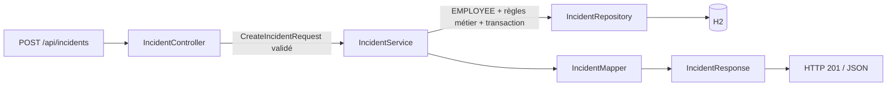

# Sentinel — Backend Spring Boot

Le backend suit une architecture en couches. La classe `BackendApplication` reste à la racine pour que Spring détecte automatiquement les composants des sous-packages.

```text
org.example.backend
├── BackendApplication.java
├── bootstrap/             # Données de démonstration, conditionnelles
├── config/                # Configuration Spring Security et CORS
├── domain/
│   ├── entity/            # User, Incident, IncidentHistory, IncidentComment, RefreshToken
│   └── enums/             # Role, Category, Priority, Status
├── dto/
│   ├── request/           # Un record validé par cas d’utilisation
│   └── response/          # Contrat JSON explicite, sans entités JPA
├── exception/             # Exceptions applicatives
├── mapper/                # Conversion des entités vers les DTO de réponse
├── repository/            # Accès aux données Spring Data JPA
├── security/              # JWT, utilisateur courant, erreurs 401/403
├── service/               # Règles métier, autorisations et transactions
├── util/                  # Normalisation commune des emails
└── web/
    ├── controller/        # Endpoints REST et validation HTTP
    └── advice/            # Gestion centralisée des erreurs
```

## Responsabilités et dépendances

Un **contrôleur** reçoit un DTO avec `@Valid`, appelle un service puis retourne un DTO de réponse. Il ne charge aucune entité, n’appelle aucun repository et ne contient ni règle métier ni transaction.

Un **service** applique les règles métier et les autorisations `@PreAuthorize`. Les lectures utilisent `@Transactional(readOnly = true)` ; les écritures ouvrent une transaction modifiable. Les vérifications de propriétaire, de technicien affecté, de compte actif et de transition sont réalisées ici. L’autorisation s’applique aussi à un appel direct au service depuis un autre composant Spring.

Un **repository** déclare les requêtes JPA. Les statistiques sont comptées en base au lieu de charger tous les utilisateurs et incidents. Les listes d’incidents utilisent `@EntityGraph` pour charger l’auteur et le technicien sans une requête supplémentaire pour chaque ligne. Les associations restent `LAZY` dans les entités.

Une **entité** décrit la persistance, avec champs privés et accesseurs. L’agrégat Incident entretient les deux côtés des relations avec `addHistory` et `addComment`. Les collections sont consultables mais ne sont pas modifiables directement par leur getter. `User.revokeSessions()` exprime la révocation sans exposer un setter de version d’authentification.

Un **DTO de requête** décrit les seules données acceptées pour une action et leurs contraintes Jakarta Validation. Un **DTO de réponse** décrit le JSON public : il n’expose jamais `password`, `authVersion` ou les relations JPA brutes. Les réponses de profil, statistiques, authentification, incident, message et erreur sont toutes typées. Les clés JSON restent compatibles avec le frontend existant.

Les **mappers** convertissent les entités en réponses. `UserMapper` construit un `UserResponse`. `IncidentMapper` sépare résumé et détail : les listes ne chargent pas historique et notes. La conversion des associations s’effectue dans la transaction du service ; les getters gèrent normalement les proxys Hibernate.

## Services

| Service | Responsabilité |
| --- | --- |
| `AuthService` | Inscription, connexion, création de session, renouvellement et déconnexion |
| `RefreshTokenService` | Génération aléatoire, hash, expiration, consommation unique et rotation |
| `ProfileService` | Consultation/modification du profil et changement du mot de passe |
| `IncidentService` | Consultation selon le rôle, création, affectation, statut, notes et historique |
| `AdminService` | Liste des utilisateurs, activation/désactivation et statistiques globales |

Le mécanisme cryptographique JWT se trouve dans `security/JwtService`. Les erreurs des filtres utilisent le même `ErrorResponse` que le `@RestControllerAdvice`, au moyen d’un writer JSON partagé ; aucune réponse d’erreur n’est assemblée par concaténation.

Les services sont des classes concrètes injectées par constructeur. Des interfaces et des classes `Impl` ne sont pas nécessaires tant qu’il n’existe qu’une implémentation par responsabilité.

## Exemple : création d’un incident



## Exécution et vérification

Depuis ce dossier :

```bash
mvn spring-boot:run
mvn test
mvn package
```

API sur **8081**. Les tests d’intégration se trouvent dans `src/test/java/org/example/backend/integration`. Ils utilisent une base H2 en mémoire isolée et vérifient aussi le refus d’actions administratives lors d’un appel direct à la couche service.

Le [README principal](../README.md) contient les comptes, la configuration, les endpoints et la collection Postman.
