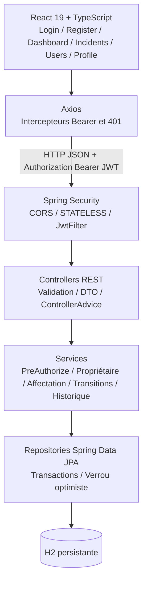
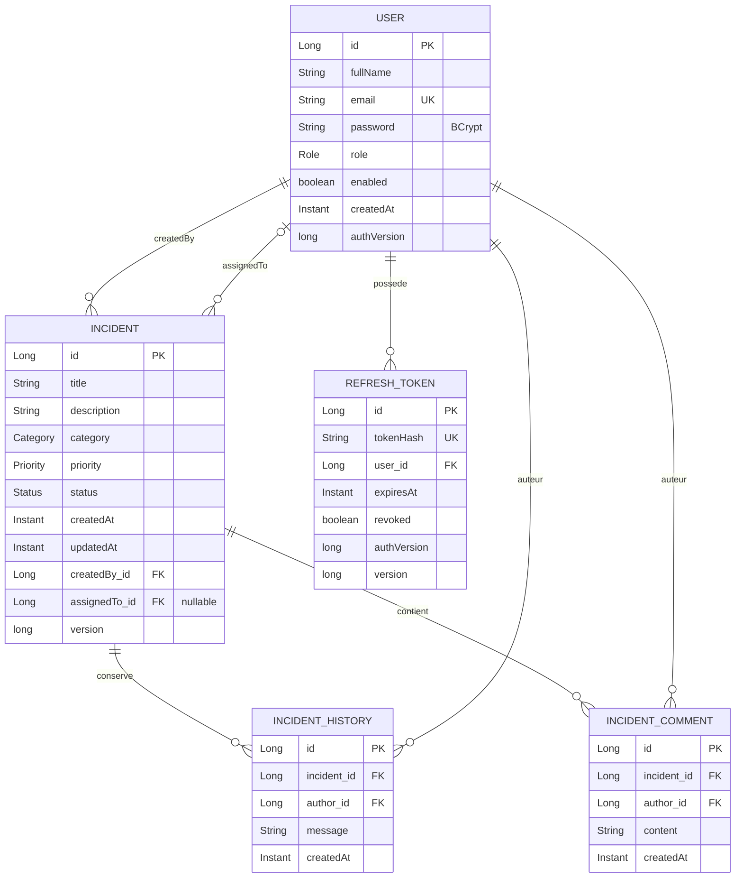

# Architecture et modèle de données

Les versions SVG consultables se trouvent dans `architecture.svg` et `entites.svg`.

Les relations `ManyToOne` sont déclarées explicitement `LAZY`. Les collections `OneToMany` d’un incident sont aussi chargées à la demande. Elles sont mappées par `incident`, ordonnées par date et identifiant, avec cascade et suppression des orphelins. Aucune collection inverse n’est nécessaire sur `User` : les requêtes de repository sélectionnent les incidents par propriétaire ou technicien. Les mappers construisent les DTO dans la transaction du service. Les accesseurs des entités initialisent les proxys Hibernate nécessaires. Les listes chargent createdBy et assignedTo avec @EntityGraph, sans charger les historiques ni les notes. Ce choix évite les graphes JSON cycliques, l’exposition du hash du mot de passe et le chargement systématique des historiques dans les listes. Pour des volumes importants, ajouter pagination et projections pour réduire les requêtes N+1.
